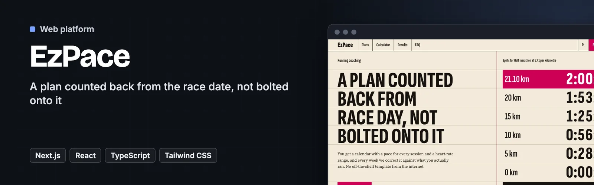
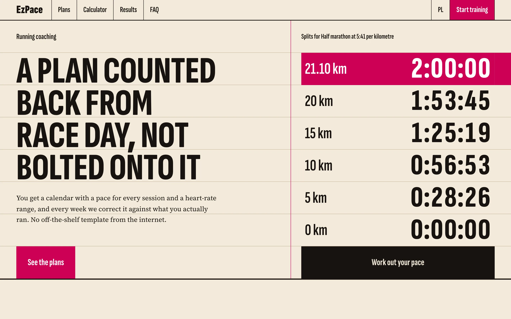
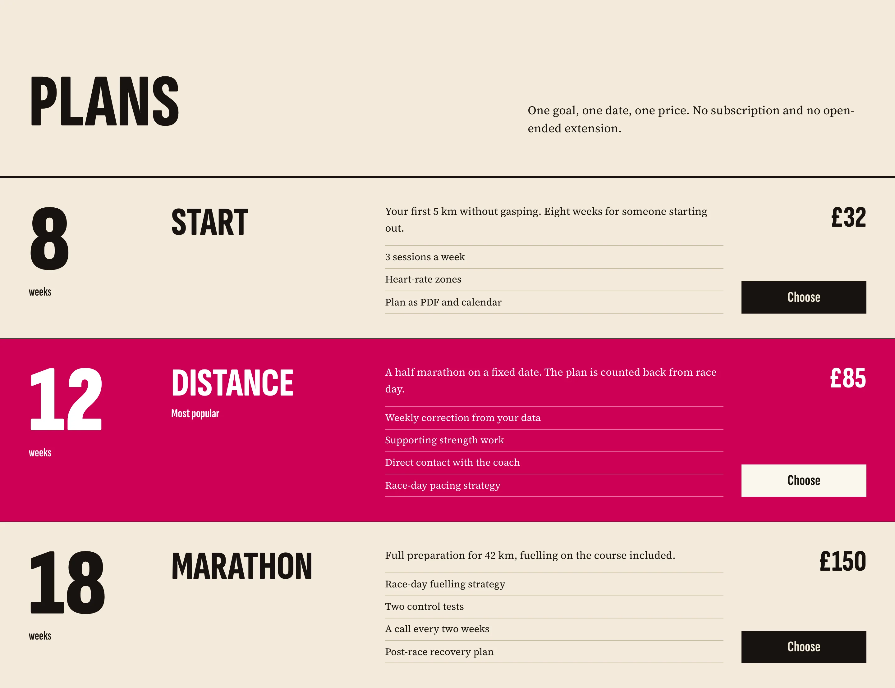
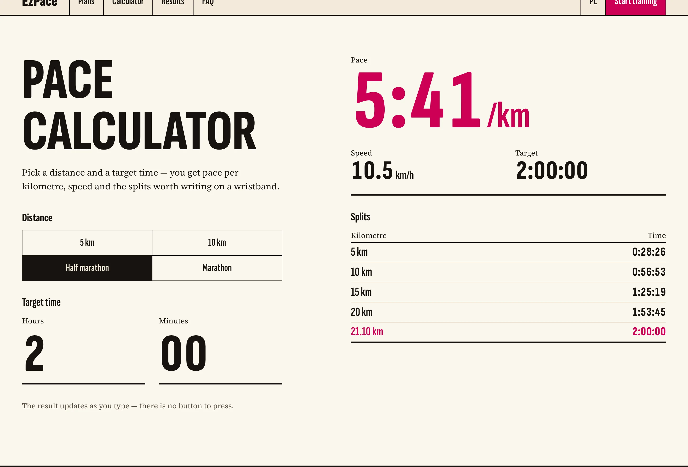
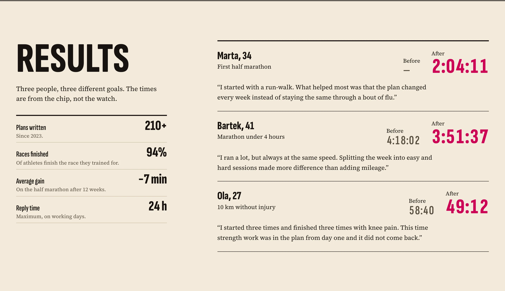
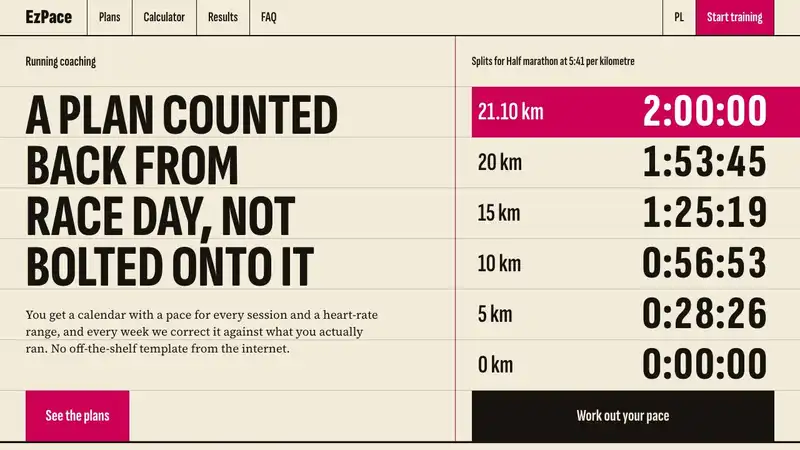

<p align="center">
  <a href="https://ezpace.dawidolko.pl/"></a>
</p>

# EzPace

> 🏃 **A plan counted back from the race date, not bolted onto it** — running coaching with a working pace calculator and a weekly correction loop

**EzPace** is a product site for a running coach, set as a printed race-day sheet: split tables, a plan ledger and a race bib on manila paper. Three plans, a calculator that actually computes, the coaching process and real-looking results. The premise is that a training plan is derived from the race date rather than appended to it, and the hero prints that literally, with a split table counted back from the finish line.

There is no backend and no database. The site is prerendered to files and served by GitHub Pages; the calculator runs entirely in the browser.

[](https://github.com/dawidolko/EzPace-Platform-NextJS/actions/workflows/deploy.yml)


**[Live site](https://ezpace.dawidolko.pl/)** · [Screenshots](#️-screenshots) · [Getting started](#-getting-started)

---

## 🎯 Key Features

- **A pace calculator that is not a mock-up** — pick a distance and a target time, get pace per kilometre, speed and the full split table, recalculated as you type.
- **Splits that include the leftover distance** — dropping the final 0.0975 km of a half marathon reports a finish about fifteen seconds early, which is exactly the error a runner notices on the course.
- **Three plans, one price each** — no subscription, no open-ended extension; each states its length and what the weekly correction covers.
- **Results with real numbers** — before and after times taken from the chip, not the watch.
- **CSS-only FAQ** — `<details>` and `<summary>`, no JavaScript required.

---

## 🖼️ Screenshots

| Hero — the premise in one screen                                          | Training plans                                                    |
| ---------------------------------------------------------------------------- | -------------------------------------------------------------------- |
|  |  |

| Pace calculator                                                                     | Results                                                          |
| -------------------------------------------------------------------------------------- | ------------------------------------------------------------------- |
|  |  |

---

## 🧮 The Pace Calculator

`src/components/pace.ts` derives everything from two inputs: the distance and the target time. `src/components/KalkulatorTempa.tsx` is the form around it, and the hero prints the same function's default case in reverse.

- **Pace** is the target time divided by the distance, formatted as `m:ss`.
- **Speed** is the distance over the time in hours.
- **Splits** land on whole kilometres plus the leftover distance, so the final row always equals the stated goal.

Verified against independent arithmetic: a 2:00 half marathon gives **5:41/km at 10.5 km/h**; a 4:30 marathon gives **6:24/km at 9.4 km/h**.

---

## 🧩 Application Layer

| Layer            | Responsibility                                                                                 |
| ---------------- | ------------------------------------------------------------------------------------------------ |
| `src/app`        | Routing, document metadata, fonts, JSON-LD and the 404 page. Two routes (`/`, `/pl/`), fully prerendered. |
| `src/components/pace.ts` | Pure pace, speed and split calculation, shared by the hero and the calculator.        |
| `src/components/KalkulatorTempa.tsx` | The stateful form: distance and target time in, pace and splits out.               |
| `src/components/StronaGlowna.tsx` | Every section of the page, used by both languages.                                    |
| `src/components/tresc.ts` | All copy in both languages: plans, process steps, figures, runner stories and FAQ entries. |
| `src/app/globals.css`    | Design tokens and the whole visual system. Components carry class names, not colours.      |

---

## 🎬 Demo

<p align="center">
  
</p>

---

## 🛠️ Technology Stack

### Frontend

| Technology   | Version | Role                                            |
| ------------ | ------- | ----------------------------------------------- |
| Next.js      | 16      | App Router with `output: 'export'`               |
| React        | 19      | Component model                                  |
| TypeScript   | 5       | Strict mode, no implicit `any`                   |
| Tailwind CSS | 4       | Utility layer on top of a token theme            |

### Infrastructure

| Technology     | Role                                             |
| -------------- | ------------------------------------------------ |
| GitHub Actions | Typecheck, build and export verification         |
| GitHub Pages   | Static hosting behind a custom domain            |

---

## 🚀 Getting Started

### Prerequisites

- Node.js 20 or newer
- npm 10 or newer

### 1. Clone the Repository

```bash
git clone https://github.com/dawidolko/EzPace-Platform-NextJS.git
cd EzPace-Platform-NextJS
```

### 2. Install Dependencies

```bash
npm install
```

### 3. Run

```bash
npm run dev        # http://localhost:3000
npm run verify     # typecheck + production build
npm run serve      # serve the exported site from out/
```

---

## 🎨 Design

A printed race-day sheet, the way a training plan looks once it is pinned to the fridge.

- **Paper and ink** — manila `#F3EBDA`, brighter bib stock `#FBF7EE` for the calculator, ink `#17130F` and one hot riso pink `#CC0055`. Nothing else competes with the pink.
- **Type** — Sofia Sans Extra Condensed for headings and every numeral, with real tabular figures in the time columns, and Source Serif 4 for reading text. Both are self-hosted woff2 subsets of about 25 KB and 33 KB that cover Polish, so no request leaves the site. Only the display face is preloaded. See `src/app/fonts/OFL.txt`.
- **One ruling** — the hero is built on a single row pitch, `--row`. The background rules, the headline leading and the split rows all use it, so every line of type lands on the same ruling at any width.
- **Counted back** — the hero table starts at the finish, 21.10 km, and runs down to 0 km. The layout makes the argument the copy makes.
- **Ruled, not carded** — plans are rows of a ledger led by their length in weeks, results read like a result sheet with running totals in the margin, and the process climbs to the right like a course profile. Buttons are flush table cells. The only framed object is the race bib with four pin holes at the end of the page.
- **One moment of motion** — on load, the split rows strike in one after another from the finish back to the start. Everything else moves only in response to the visitor, and `prefers-reduced-motion` removes it.

---

## ♿ Accessibility

- One `<h1>` per page, no skipped heading levels.
- Skip link as the first focusable element, `<main id="main-content">` as its target.
- Calculator results announced through `aria-live`, so a screen-reader user hears the new pace as the inputs change.
- The split table carries a `<caption>` and `scope` on every header cell.
- Distance selection is a real radio group inside a `<fieldset>` with a `<legend>`, operable from the keyboard.
- `prefers-reduced-motion` honoured across every transition.

An accessibility panel in the corner of every page changes text size, contrast, font and motion, and remembers the choice on the device. It sits on top of the markup and does not replace accessible markup.

---

## 📁 Project Structure

```
src/
├── app/
│   ├── (en)/                 English route, metadata and JSON-LD
│   ├── (pl)/                 Polish route, metadata and JSON-LD
│   ├── fonts/                self-hosted woff2 subsets and their licence
│   ├── fonts.ts              font loading
│   ├── global-not-found.tsx  the 404 page
│   └── globals.css           design tokens and the visual system
└── components/
    ├── tresc.ts              copy in both languages
    ├── pace.ts               pace, speed and split calculation
    ├── StronaGlowna.tsx      every section of the page
    ├── KalkulatorTempa.tsx   calculator form and output
    ├── SiteHeader.tsx        ruled sticky masthead with a mobile menu
    └── SiteFooter.tsx
```

---

## 📄 License

MIT — see [LICENSE](LICENSE).

---

## 👨‍💻 Author

**Dawid Olko** · Fullstack / AI Developer

[Portfolio](https://olkodawid.dawidolko.pl) · [CV](https://cv.dawidolko.pl) · [LinkedIn](https://www.linkedin.com/in/dawidolko/) · [GitHub](https://github.com/dawidolko)
